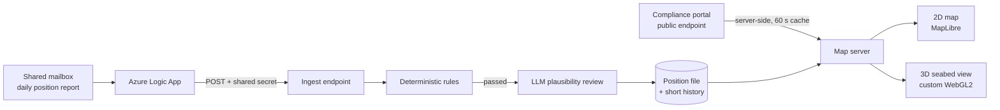

# Public Maritime Operations Map (case study)

[Português](README.md) · **English**

A public web map that shows where offshore seismic survey operations are planned and where the survey vessel last reported its position, updated from e-mailed position reports through deterministic validation plus an LLM plausibility review, with a custom WebGL2 seabed view built from public bathymetry.

Built during my work at [Toveri](https://toveri.com.br), an environmental consultancy that monitors offshore operations. Documentation only: no source code, client names, data or infrastructure identifiers.

> This repository is documentation only. The source code, data and infrastructure belong to the employer and are not published here. See [What is intentionally omitted](#what-is-intentionally-omitted).

## Problem

Seismic survey vessels tow several kilometres of cable and cannot manoeuvre quickly. Small-scale fishers working the same waters need a simple, current answer to "where is the survey working this week, and where was the vessel last reported", without logging in and without reading technical notices.

The information already existed, but in the wrong form:

- planned operation areas and periods were managed in an internal compliance portal (see the companion case study);
- the vessel's position arrived once a day as a plain-text maritime traffic position report e-mailed to a shared mailbox.

The goal was a map that updates itself from those two sources, never needs a redeploy to change content, and never displays data it has not validated.

## My role

Sole developer: product shape, implementation, tests, Azure deployment and operation. All 35 commits (16 Sep to 18 Nov 2026) are mine. I used AI-assisted development (Claude Code) throughout; design decisions, review and production responsibility are mine.

## Architecture

- **Operations** (areas, routes, periods) come from the compliance portal's public endpoint, fetched server-side only and cached for 60 seconds. The map app has no database of its own.
- **Vessel positions** arrive through an Azure Logic App (Consumption plan) that polls the shared mailbox, posts the report text to the ingest endpoint, and e-mails the operator the result.
- **Two views of the same data and filters:** a 2D operational map (MapLibre GL) and a 3D "perspective" view of the seabed.

## Ingest pipeline: rules first, LLM second

1. **Authenticate.** The endpoint is disabled (404) unless a secret of at least 16 characters is configured. The presented secret is compared in constant time (both values are SHA-256 hashed first, so neither length nor content leaks through timing). Request bodies are capped at 256 KB.
2. **Parse.** Outlook HTML bodies are converted to text; the report's date-time and position fields are extracted with tolerant regular expressions (a malformed field has a documented fallback). No readable position: status "ignored".
3. **Deterministic rules.** The report must be newer than the last published one (otherwise "no change", which makes re-delivery idempotent); it must fall inside a configured regional bounding box; and the implied speed since the previous report (great-circle distance over elapsed time) must not exceed 15 knots. Whether the position lies inside the published work area (ray-casting point-in-polygon, holes respected) is computed but informative only. Any failure: status "held", nothing published.
4. **LLM review.** Only reports that passed every rule are sent to Claude (Anthropic API) with the new report, the last ten published positions, the operation period and work-area polygon, and the rule results. The model answers in a strict JSON schema and can only *hold back* a publication (implausible jump, position on land, date outside the operation period, internally inconsistent fields). It cannot publish something the rules rejected, and it never writes the position line: that text is always generated deterministically, and the model only appends a short comment.
5. **Publish.** The position and a ten-entry history are written to a JSON file on the App Service's persistent storage; readers cache it for 60 seconds. Ingests are serialized in-process so two near-simultaneous deliveries cannot interleave read-decide-write.

If the model is not configured, times out, errors or returns something that does not parse, the report is published on the rules alone and the notification says so explicitly. This fail-open choice is deliberate: the report is the vessel's official declaration, the rules already bound the damage, and a silent stall would be worse for the people relying on the map.

## 3D seabed view

The perspective view is a MapLibre custom layer written directly against WebGL2, with no 3D library dependency:

- **Data.** A Python build script turns one public GEBCO grid into two levels: a coarse 2 arc-minute level over the whole reachable area (8x8 area mean of the source grid) and the native 15 arc-second level over the area of interest. Heights are true metres, not smoothed or exaggerated at build time, encoded losslessly in WebP tiles (elevation + 32768 split across two 8-bit channels). The output folder name carries a version, so tiles can be cached as immutable.
- **Geometry.** Quadtree level of detail by screen-space size with frustum culling. Each patch is a 32x32 grid generated entirely in the vertex shader from `gl_VertexID` / `gl_InstanceID` (no vertex or index buffers), with skirts; every patch samples the same height function, so LOD transitions leave no cracks.
- **Shading.** Relief shading, isobaths and area tint are computed per pixel from the same heights; operation areas, routes and waypoints are draped on the surface, and a drop line connects each reported vessel at the sea surface to the seabed below it.
- **Robustness.** Tiles are streamed nearest-first and cached for the page lifetime; a quality governor coarsens the mesh and caps the pixel ratio when frames miss 60 Hz; the layer is re-created after a WebGL context loss.
- **Why custom.** It replaced an earlier version built on MapLibre's built-in raster-DEM terrain from the same data. In an A/B recorded in the project notes, the custom layer produced the same seam-free surface with about 2.7x less frame time, no main-thread long tasks while navigating, and roughly a quarter of the JavaScript heap.

## Key engineering decisions

- **No database in the map app.** Operations stay owned by the compliance portal; positions are a single small file. Content changes never require a rebuild or redeploy.
- **Never present fixture data as real.** If the portal endpoint fails in production, the map shows an explicit "unavailable" state; falling back to sample data is only allowed outside production, and that guarantee is covered by a test.
- **Server-side only access to the portal.** The browser never calls the portal; the map server re-projects the payload onto the fields it uses, so a new upstream field cannot reach the browser without a code change here.
- **Open access, login kept as an opt-in.** The product decision was a public map with no login. The original authentication (scrypt password hash, HMAC-SHA256 signed cookie, 12-hour lifetime) stays in the code, tested in both modes, and can be re-enabled through a runtime setting without a rebuild.
- **Model configurable at runtime.** The review model is read from an app setting at call time; the stable system prompt is marked for prompt caching; prompts and full answers are not logged.
- **"Last reported position", not tracking.** The UI labels the position as the vessel's declaration at a given time, not real-time location, and marks stale reports.

## Stack

- Next.js 16.2 (App Router), React 19, TypeScript, Tailwind CSS 4
- MapLibre GL JS 5, raw WebGL2 (custom layer and GLSL shaders)
- `@anthropic-ai/sdk` (plausibility review)
- Azure App Service (Linux, Node 22), Azure Logic App (Consumption) defined as an ARM template, Office 365 connector
- Python with numpy, SciPy and Pillow (offline bathymetry tile builder)
- Vitest, ESLint

## Testing and quality

- **17 Vitest test files**: report parsing and HTML normalisation, the deterministic rules, the LLM-opinion parser (malformed or out-of-schema answers become "unavailable"), the ingest flow with an injected fake reviewer, the position store, the portal data loader (including the no-fixture-in-production guarantee), authentication in both modes, camera maths, operation geometry, and a seabed test that checks the client's tile mapping against the builder's metadata.
- One integration test against a live portal endpoint skips itself unless an environment variable points to one.
- No CI pipeline and no browser end-to-end tests yet.

## Status

In production on Azure App Service, open to the public. Repository history starts on 16 Sep 2026; the open-access decision dates from 28 Sep 2026, the 3D seabed view from 15 Nov 2026 and the cloud ingest pipeline from 17 Nov 2026. Additional position sources for other vessels are in development on a separate branch and are not described here.

## What is intentionally omitted

- **Source code and the ARM template.** Employer property; the template also encodes mailbox and resource names.
- **Vessel identities, reports, coordinates and operation areas.** Operational data of a client; the description above uses no real positions.
- **The review prompt's full text.** It encodes domain knowledge specific to the client's operations; its structure (inputs, refusal criteria, strict output schema) is described above.
- **Hostnames, resource names and secrets.** No portfolio value, only attack surface.

## Lessons and next steps

- **Put the repository on a remote and add CI.** For most of its life this project existed only in a synced local folder; that is a real risk and the first thing to fix.
- **Automate the deployment.** It is a manual standalone build, asset copy and zip upload, without the post-build script the portal already has.
- **Anonymize test fixtures** so the test suite can be shared and run anywhere.
- **Retire the duplicate path.** A local desktop agent (see the e-mail agents case study) still runs the same rules in parallel; both paths are idempotent ("no change" on a repeat), but there should be one owner.
- **What worked:** making the LLM a constrained reviewer with veto power only, behind deterministic rules and in front of a human-readable notification, made it safe to let the pipeline publish without a human in the loop.

More detail on specific decisions: [docs/decisions.md](docs/decisions.md).
