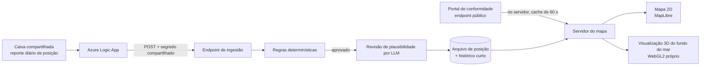

# Mapa Público de Operações Marítimas (estudo de caso)

**Português** · [English](README.en.md)

Um mapa web público que mostra onde estão planejadas operações de pesquisa sísmica offshore e onde o navio de pesquisa reportou sua posição pela última vez, atualizado a partir de reportes de posição enviados por e-mail, com validação determinística seguida de uma revisão de plausibilidade por LLM, e com uma visualização 3D do fundo do mar em WebGL2 própria, construída a partir de batimetria pública.

Desenvolvido durante meu trabalho na [Toveri](https://toveri.com.br), uma consultoria ambiental que monitora operações offshore. Apenas documentação: sem código-fonte, nomes de clientes, dados ou identificadores de infraestrutura.

> Este repositório contém apenas documentação. O código-fonte, os dados e a infraestrutura pertencem ao empregador e não estão publicados aqui. Veja [O que foi omitido intencionalmente](#o-que-foi-omitido-intencionalmente).

## Problema

Navios de pesquisa sísmica rebocam vários quilômetros de cabo e não conseguem manobrar rapidamente. Pescadores artesanais que trabalham nas mesmas águas precisam de uma resposta simples e atualizada para "onde a pesquisa está trabalhando esta semana, e onde o navio foi reportado pela última vez", sem fazer login e sem ler avisos técnicos.

A informação já existia, mas no formato errado:

- as áreas e os períodos planejados de operação eram gerenciados em um portal interno de conformidade (veja o estudo de caso complementar);
- a posição do navio chegava uma vez por dia como um reporte de posição de tráfego marítimo em texto simples, enviado por e-mail para uma caixa compartilhada.

O objetivo era um mapa que se atualizasse sozinho a partir dessas duas fontes, nunca precisasse de redeploy para mudar o conteúdo e nunca exibisse dados não validados.

## Meu papel

Desenvolvedor único: definição do produto, implementação, testes, deploy no Azure e operação. Todos os 35 commits (16 set a 18 nov 2026) são meus. Usei desenvolvimento assistido por IA (Claude Code) durante todo o projeto; as decisões de design, a revisão e a responsabilidade pela produção são minhas.

## Arquitetura

- **Operações** (áreas, rotas, períodos) vêm do endpoint público do portal de conformidade, buscadas apenas no servidor e mantidas em cache por 60 segundos. O app do mapa não tem banco de dados próprio.
- **Posições do navio** chegam por meio de um Azure Logic App (plano Consumption) que consulta a caixa compartilhada, envia o texto do reporte ao endpoint de ingestão e manda o resultado por e-mail ao operador.
- **Duas visualizações dos mesmos dados e filtros:** um mapa operacional 2D (MapLibre GL) e uma visualização 3D em "perspectiva" do fundo do mar.

## Pipeline de ingestão: regras primeiro, LLM depois

1. **Autenticar.** O endpoint fica desativado (404) a menos que um segredo de pelo menos 16 caracteres esteja configurado. O segredo apresentado é comparado em tempo constante (os dois valores passam antes por hash SHA-256, de modo que nem o tamanho nem o conteúdo vazam pelo tempo de resposta). O corpo das requisições é limitado a 256 KB.
2. **Parsing.** Corpos HTML do Outlook são convertidos em texto; a data-hora e os campos de posição do reporte são extraídos com expressões regulares tolerantes (um campo malformado tem um fallback documentado). Sem posição legível: status "ignored".
3. **Regras determinísticas.** O reporte precisa ser mais recente que o último publicado (caso contrário, "no change", o que torna a reentrega idempotente); precisa estar dentro de uma bounding box regional configurada; e a velocidade implícita desde o reporte anterior (distância ortodrômica dividida pelo tempo decorrido) não pode passar de 15 nós. Se a posição está dentro da área de trabalho publicada (point-in-polygon por ray casting, respeitando buracos) é calculado, mas apenas como informação. Qualquer falha: status "held", nada é publicado.
4. **Revisão por LLM.** Apenas reportes que passaram em todas as regras são enviados ao Claude (API da Anthropic), junto com o novo reporte, as dez últimas posições publicadas, o período da operação e o polígono da área de trabalho, e os resultados das regras. O modelo responde em um schema JSON estrito e só pode *segurar* uma publicação (salto implausível, posição em terra, data fora do período da operação, campos internamente inconsistentes). Ele não pode publicar algo que as regras rejeitaram e nunca escreve a linha de posição: esse texto é sempre gerado de forma determinística, e o modelo apenas acrescenta um comentário curto.
5. **Publicar.** A posição e um histórico de dez entradas são gravados em um arquivo JSON no armazenamento persistente do App Service; os leitores mantêm esse arquivo em cache por 60 segundos. As ingestões são serializadas no processo, para que duas entregas quase simultâneas não intercalem o ciclo ler-decidir-gravar.

Se o modelo não estiver configurado, estourar o tempo, der erro ou devolver algo que não pode ser interpretado, o reporte é publicado apenas com base nas regras, e a notificação diz isso explicitamente. Essa escolha de fail-open é deliberada: o reporte é a declaração oficial do navio, as regras já limitam o dano, e uma parada silenciosa seria pior para quem depende do mapa.

## Visualização 3D do fundo do mar

A visualização em perspectiva é uma custom layer do MapLibre escrita diretamente sobre WebGL2, sem depender de nenhuma biblioteca 3D:

- **Dados.** Um script de build em Python transforma uma grade pública do GEBCO em dois níveis: um nível grosseiro de 2 minutos de arco sobre toda a área alcançável (média de áreas 8x8 da grade de origem) e o nível nativo de 15 segundos de arco sobre a área de interesse. As alturas são metros reais, sem suavização nem exagero no build, codificadas sem perdas em tiles WebP (elevação + 32768 dividida em dois canais de 8 bits). O nome da pasta de saída carrega uma versão, então os tiles podem ser cacheados como imutáveis.
- **Geometria.** Nível de detalhe em quadtree pelo tamanho em tela, com frustum culling. Cada patch é uma grade 32x32 gerada inteiramente no vertex shader a partir de `gl_VertexID` / `gl_InstanceID` (sem vertex buffers nem index buffers), com skirts; todo patch amostra a mesma função de altura, então as transições de LOD não deixam fissuras.
- **Sombreamento.** O sombreamento de relevo, as isóbatas e a coloração das áreas são calculados por pixel a partir das mesmas alturas; áreas de operação, rotas e waypoints são projetados sobre a superfície, e uma linha vertical liga cada navio reportado, na superfície do mar, ao fundo logo abaixo dele.
- **Robustez.** Os tiles são carregados do mais próximo para o mais distante e ficam em cache durante a vida da página; um controlador de qualidade simplifica a malha e limita o pixel ratio quando os quadros não atingem 60 Hz; a layer é recriada após uma perda de contexto WebGL.
- **Motivação para a implementação própria.** Substituiu uma versão anterior construída sobre o terreno raster-DEM nativo do MapLibre, a partir dos mesmos dados. Em um teste A/B registrado nas notas do projeto, a layer própria produziu a mesma superfície sem emendas com cerca de 2,7x menos tempo de quadro, nenhuma long task na thread principal durante a navegação e aproximadamente um quarto do heap de JavaScript.

## Principais decisões de engenharia

- **Sem banco de dados no app do mapa.** As operações continuam pertencendo ao portal de conformidade; as posições são um único arquivo pequeno. Mudanças de conteúdo nunca exigem rebuild ou redeploy.
- **Nunca apresentar dados de fixture como reais.** Se o endpoint do portal falhar em produção, o mapa mostra um estado explícito de "indisponível"; recorrer a dados de exemplo só é permitido fora de produção, e essa garantia é coberta por um teste.
- **Acesso ao portal apenas pelo servidor.** O navegador nunca chama o portal; o servidor do mapa reprojeta o payload para os campos que usa, de modo que um campo novo vindo do upstream não chega ao navegador sem uma mudança de código aqui.
- **Acesso aberto, login mantido como opção.** A decisão de produto foi um mapa público sem login. A autenticação original (hash de senha scrypt, cookie assinado com HMAC-SHA256, validade de 12 horas) continua no código, testada nos dois modos, e pode ser reativada por uma configuração em tempo de execução, sem rebuild.
- **Modelo configurável em tempo de execução.** O modelo de revisão é lido de uma app setting no momento da chamada; o system prompt estável é marcado para prompt caching; prompts e respostas completas não são registrados em log.
- **"Última posição reportada", não rastreamento.** A interface rotula a posição como a declaração do navio em um dado momento, não como localização em tempo real, e marca os reportes desatualizados.

## Stack

- Next.js 16.2 (App Router), React 19, TypeScript, Tailwind CSS 4
- MapLibre GL JS 5, WebGL2 puro (custom layer e shaders GLSL)
- `@anthropic-ai/sdk` (revisão de plausibilidade)
- Azure App Service (Linux, Node 22), Azure Logic App (Consumption) definido como template ARM, conector do Office 365
- Python com numpy, SciPy e Pillow (gerador offline de tiles de batimetria)
- Vitest, ESLint

## Testes e qualidade

- **17 arquivos de teste Vitest**: interpretação de reportes e normalização de HTML, as regras determinísticas, o parser da opinião do LLM (respostas malformadas ou fora do schema viram "unavailable"), o fluxo de ingestão com um revisor falso injetado, o armazenamento de posições, o carregador de dados do portal (incluindo a garantia de nenhuma fixture em produção), a autenticação nos dois modos, a matemática da câmera, a geometria das operações e um teste do fundo do mar que confere o mapeamento de tiles do cliente com os metadados do gerador.
- Um teste de integração contra um endpoint real do portal é ignorado (skip), a menos que uma variável de ambiente aponte para um.
- Ainda não há pipeline de CI nem testes end-to-end no navegador.

## Status

Em produção no Azure App Service, aberto ao público. O histórico do repositório começa em 16 set 2026; a decisão de acesso aberto é de 28 set 2026, a visualização 3D do fundo do mar de 15 nov 2026 e o pipeline de ingestão na nuvem de 17 nov 2026. Fontes adicionais de posição para outros navios estão em desenvolvimento em uma branch separada e não são descritas aqui.

## O que foi omitido intencionalmente

- **Código-fonte e o template ARM.** Propriedade do empregador; o template também contém nomes de caixas de e-mail e de recursos.
- **Identidade dos navios, reportes, coordenadas e áreas de operação.** Dados operacionais de um cliente; a descrição acima não usa nenhuma posição real.
- **O texto completo do prompt de revisão.** Ele contém conhecimento de domínio específico das operações do cliente; sua estrutura (entradas, critérios de recusa, schema de saída estrito) está descrita acima.
- **Hostnames, nomes de recursos e segredos.** Sem valor para portfólio, apenas superfície de ataque.

## Lições e próximos passos

- **Colocar o repositório em um remoto e adicionar CI.** Durante a maior parte da sua vida, este projeto existiu apenas em uma pasta local sincronizada; é um risco real e a primeira coisa a corrigir.
- **Automatizar o deploy.** Hoje é um build standalone manual, cópia de assets e upload de zip, sem o script pós-build que o portal já tem.
- **Anonimizar as fixtures de teste** para que a suíte possa ser compartilhada e rodar em qualquer lugar.
- **Aposentar o caminho duplicado.** Um agente local de desktop (veja o estudo de caso dos agentes de e-mail) ainda roda as mesmas regras em paralelo; os dois caminhos são idempotentes ("no change" em uma repetição), mas deveria haver um único responsável.
- **O que funcionou:** fazer do LLM um revisor restrito, com poder apenas de veto, atrás de regras determinísticas e à frente de uma notificação legível por pessoas, tornou seguro deixar o pipeline publicar sem human-in-the-loop.

Mais detalhes sobre decisões específicas: [docs/decisoes.md](docs/decisoes.md).

---

> © Henry Noguchi. **Todos os direitos reservados.** Repositório público só para leitura; copiar, reutilizar ou apresentar como próprio exige autorização. Ver [LICENSE](LICENSE).
